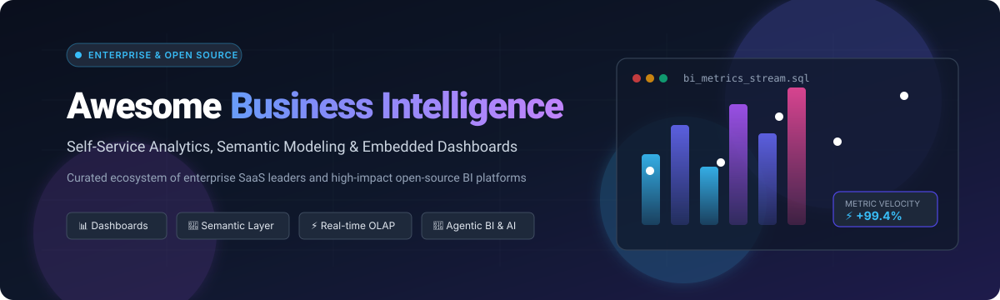

# Awesome Business Intelligence (BI) 📊✨

  

  
  
  
  
  
  

> **The definitive curated list of enterprise SaaS Business Intelligence (BI) platforms and open-source analytics repositories. Explore modern self-service reporting, semantic modeling layers, real-time OLAP engines, and AI-native data dashboards.**

---

## 📑 Table of Contents

- [🌐 Sector Overview & Market Dynamics](#-sector-overview--market-dynamics)
- [💼 SaaS & Hosted BI Platforms](#-saas--hosted-bi-platforms)
- [🚀 Open-Source GitHub Projects](#-open-source-github-projects)
  - [⭐ Top Open-Source BI & Semantic Engines](#-top-open-source-bi--semantic-engines)
  - [⚡ High-Performance OLAP & Query Engines](#-high-performance-olap--query-engines)
- [🏗️ Recommended Architecture Stacks](#-recommended-architecture-stacks)
- [🤝 How to Contribute](#-how-to-contribute)
- [💖 Support](#-support)
- [📜 Disclaimer](#-disclaimer)
- [📈 Star History](#-star-history)

---

## 🌐 Sector Overview & Market Dynamics

The global Business Intelligence (BI) and analytics software market is valued at approximately **$30 billion to $35 billion**, compounding at a healthy **8%–11% CAGR toward $50+ billion by 2030**. 

The sector's market structure is **moderately fragmented across specialized workloads, yet intensely concentrated at the summit**:
- **Enterprise Concentration:** Megavendors such as Microsoft, Salesforce, and Google command dominant enterprise market share and budget allocations through tightly bundled ecosystem lock-in (Microsoft 365/Fabric, Salesforce CRM/Tableau, and Google Cloud Looker).
- **Specialized & Open Fragmentation:** A vibrant secondary market thrives where modern organizations demand unbundled composability, developer-first semantic modeling (e.g. Cube, dbt), warehouse-native execution (DuckDB, ClickHouse), and open-source self-hosted sovereignty without per-seat licensing penalties.

---

## 💼 SaaS & Hosted BI Platforms

The table below catalogs leading commercial SaaS BI platforms, ranked by **company size / valuation (descending)**, detailing specific entry pricing and free tier/trial boundaries:

| 🏷️ Product | 🏢 Company Revenue / Valuation | 💳 Starting Tier Pricing | 🎁 Free Tier / Trial Limit | 📝 Key Capabilities & Focus |
| :--- | :--- | :--- | :--- | :--- |
| **[Microsoft Power BI](https://powerbi.microsoft.com/)** | **$3.0T+** (Microsoft Market Cap; ~$245B+ revenue) | **$10/user/month** (Power BI Pro) or **$20/user/month** (Power BI Premium per user) | **Free forever tier**: Power BI Desktop is 100% free for individual local authoring/reporting (cloud sharing/collaboration requires paid license or 60-day free Pro trial) | Enterprise business analytics integrated with Microsoft Fabric, Copilot AI, and Direct Lake querying on OneLake. |
| **[Looker (Google Cloud)](https://looker.com/)** | **$2.0T+** (Alphabet/Google Market Cap; ~$350B+ revenue) | **$5,000/month** (Looker Standard platform base, includes 10 standard & 2 developer users) | **Free trial**: 30-day guided evaluation / proof-of-concept trial via Google Cloud sales/credits (no perpetual free tier) | Cloud-native enterprise semantic modeling via LookML, Git version control, embedded analytics, and developer APIs. |
| **[Looker Studio](https://lookerstudio.google.com/)** | **$2.0T+** (Alphabet/Google Market Cap; ~$350B+ revenue) | **$9/user/project/month** (Looker Studio Pro) | **Free forever tier**: Unlimited reports and dashboards with 200+ free native connectors (BigQuery, Google Sheets, GA4, etc.) | Lightweight, accessible self-service visual reporting and dashboarding integrated natively with Google Workspace. |
| **[Tableau](https://www.tableau.com/)** | **$250B+** (Salesforce Market Cap; ~$38B revenue; acquired for $15.7B) | **$15/user/month** (Tableau Viewer) / **$42/user/month** (Explorer) / **$75/user/month** (Creator, billed annually) | **Free trial**: 14-day fully functional trial of Tableau Cloud/Desktop; **Free forever**: Tableau Public (10 GB storage, all work is publicly visible) | Premier data visualization platform featuring Tableau Pulse, Tableau Agent, and deep enterprise visual analytics. |
| **[MicroStrategy](https://www.microstrategy.com/)** | **$45B+** (MicroStrategy Inc. Market Cap; ~$500M annual software revenue) | **~$13/user/month** (MicroStrategy ONE entry/Standard cloud reporting) | **Free trial**: 30-day evaluation trial with MicroStrategy Auto Express AI bots and cloud environments | Enterprise analytics with governed data discovery, semantic architecture, HyperIntelligence, and mobile reporting. |
| **[ThoughtSpot](https://www.thoughtspot.com/)** | **$4.5B** (Valuation at latest funding round; ~$150M+ ARR) | **$95/month** (ThoughtSpot Essentials / Developer tier, includes 5 million query credits) | **Free trial**: 30-day free trial on cloud with full access to Search & Spotter AI agent | Search- and AI-driven agentic analytics platform powered by natural language, Spotter AI, and composable embedded SDKs. |
| **[Qlik Sense](https://www.qlik.com/)** | **$3B+** (Private equity valuation / Thoma Bravo acquisition; ~$750M+ revenue) | **$825/month** (Standard Cloud package for up to 25 full users, billed annually) | **Free trial**: 30-day full-feature trial of Qlik Cloud Analytics with sample apps and connectors | Associative calculation engine uncovering hidden data relationships without predefined SQL, plus guided/embedded analytics. |
| **[Sisense](https://www.sisense.com/)** | **$1.0B+** (Unicorn valuation; ~$150M ARR) | **~$830/month** (~$10,000/year base entry tier for small deployments/Compose SDK) | **Free trial**: 30-day fully functional trial for cloud and embedded Compose SDK | Developer-first embedded analytics platform featuring ElastiCube in-memory data modeling and AI-powered predictive metrics. |
| **[Domo](https://www.domo.com/)** | **~$400M** (Public Market Cap / NASDAQ: DOMO; ~$320M annual revenue) | **$300/month** (Standard package with 30-day flex credit allotment) | **Free forever tier**: Free plan with up to 300 credits/month, full platform access, and 1,000+ connectors (or 30-day extended trial) | Cloud-native end-to-end data product platform with Magic ETL, pre-built app connectors, and workflow automation. |
| **[GoodData](https://www.gooddata.com/)** | **~$250M** (Total venture funding raised; private valuation) | **$1,500/month** (Professional tier platform fee, includes unlimited users and data) | **Free trial**: 30-day full-feature trial of GoodData.AI cloud with embedded analytics and semantic layers | Composable analytics platform featuring Analytics Lake architecture, Apache Iceberg/DuckDB support, and multi-tenant isolation. |

---

## 🚀 Open-Source GitHub Projects

Open-source BI enables vendor independence, full data sovereignty, zero per-seat licensing penalties, and reproducible Git-based metric governance.

All repositories below are strictly sorted by **GitHub Stars (descending)** with dynamic social star badges linking directly to each project's stargazers community.

### ⭐ Top Open-Source BI & Semantic Engines

- **[Grafana](https://github.com/grafana/grafana)**   
  *The open and composable observability and operational data visualization suite (AGPL-3.0).*  
  While universally celebrated for infrastructure monitoring, Grafana is extensively deployed as an operational BI platform connecting to PostgreSQL, MySQL, ClickHouse, Snowflake, BigQuery, and Elasticsearch with dynamic multi-variable dashboards and threshold-based alerting.

- **[Apache Superset](https://github.com/apache/superset)**   
  *Modern, enterprise-ready business intelligence web application and exploration platform (Apache-2.0).*  
  Born at Airbnb and incubated under the Apache Software Foundation, Superset is the leading open-source alternative to Tableau and Looker. Delivers a zero-code visualization builder, interactive SQL Lab IDE, native semantic modeling layer, and seamless connectivity to 40+ databases via SQLAlchemy.

- **[Metabase](https://github.com/metabase/metabase)**   
  *The easiest, fastest self-service analytics and dashboarding platform for modern companies (AGPL-3.0).*  
  Ships as a single lightweight JAR/Docker container that non-technical business users can immediately operate. Offers a visual graphical query builder, Metabot AI natural language assistance, automated scheduled reports via Slack/email, granular collection permissions, and frictionless embedded analytics.

- **[Redash](https://github.com/getredash/redash)**   
  *Developer-centric SQL query editor, visualizer, and dashboard builder (BSD-2-Clause).*  
  Built from the ground up for technical analysts who prefer raw SQL. Supports 35+ relational and NoSQL databases, live schema discovery, snippet libraries, scheduled queries, parameter-based filters, and automated webhook alerting.

- **[DataEase](https://github.com/dataease/dataease)**   
  *Open-source self-service data visualization and modern BI tool (GPL-3.0).*  
  Offers an intuitive drag-and-drop dashboard designer, rich visual templates, fine-grained permission controls, and broad connectivity across MySQL, Oracle, PostgreSQL, SQL Server, Excel, and Apache Doris.

- **[Cube](https://github.com/cube-js/cube)**   
  *The universal semantic layer for AI, BI, and data applications (Apache-2.0).*  
  Cube sits between modern cloud data warehouses and downstream frontends, centralizing metric definitions, caching query acceleration with pre-aggregations, enforcing multi-tenant row-level access, and exposing metrics via SQL API, REST API, and GraphQL.

- **[PyGWalker](https://github.com/Kanaries/pygwalker)**   
  *Turn your pandas/polars dataframes into a Tableau-like visual exploration UI in Jupyter (Apache-2.0).*  
  A lightweight Python library that embeds an interactive Graphic Walker interface inside notebooks, enabling instant drag-and-drop graphic exploration, chart composition, and metric inspection without writing code.

- **[Evidence](https://github.com/evidence-dev/evidence)**   
  *Business intelligence as code: markdown + SQL reporting (MIT).*  
  A modern static-site and server-rendered BI architecture where analytical reports are authored in Markdown and parameterized SQL. Fully version-controlled via Git, reviewable through pull requests, reproducible, and blazingly fast.

- **[Lightdash](https://github.com/lightdash/lightdash)**   
  *The open-source BI platform natively integrated with your dbt project (MIT).*  
  Transforms your existing dbt models into a full self-service exploration platform. Metrics and dimensions defined in dbt YAML files synchronize automatically with Lightdash, eliminating metric duplication between engineering and business stakeholders.

- **[Rill](https://github.com/rilldata/rill)**   
  *Fast, code-first BI for operational analytics on DuckDB and ClickHouse (Apache-2.0).*  
  Combines an embedded analytics database with an ultra-responsive UI, allowing users to explore gigabytes of event data with sub-second feedback loops and Git-tracked metrics definitions.

- **[Knowage](https://github.com/KnowageLabs/Knowage-Server)**   
  *Comprehensive enterprise open-source suite for business analytics and data federation (AGPL-3.0).*  
  Maintained by Engineering Group, providing specialized modules for enterprise pixel-perfect reporting, location intelligence, multidimensional OLAP cubes, KPI dashboards, and advanced R/Python analytics.

---

### ⚡ High-Performance OLAP & Query Engines

The BI presentation layer relies on sub-second analytical databases for interactive dashboards:

- **[ClickHouse](https://github.com/ClickHouse/ClickHouse)**  — Fast open-source columnar database management system for real-time analytical reporting (Apache-2.0).
- **[DuckDB](https://github.com/duckdb/duckdb)**  — An in-process SQL OLAP database management system; the "SQLite of analytics" powering modern embedded BI (MIT).
- **[Apache Doris](https://github.com/apache/doris)**  — Easy-to-use, high-performance, and unified analytical database for real-time reporting and ad-hoc analysis (Apache-2.0).
- **[Apache Druid](https://github.com/apache/druid)**  — High-performance, real-time analytics database designed for streaming and event-driven BI workloads (Apache-2.0).
- **[Trino](https://github.com/trinodb/trino)**  — Fast distributed SQL query engine for big data analytics running ad-hoc federated queries over data lakes (Apache-2.0).
- **[StarRocks](https://github.com/StarRocks/starrocks)**  — Next-gen sub-second MPP database for full-scenario analytics, supporting real-time ingestion and materialized lakehouse views (Apache-2.0).

---

## 🏗️ Recommended Architecture Stacks

| Deployment Pattern | Semantic Layer | Query / Storage Layer | BI Visualization Frontend | Target Use Case |
| :--- | :--- | :--- | :--- | :--- |
| **All-in-One Self-Hosted** | Built-in models | PostgreSQL / Snowflake / BigQuery | **Metabase** | Startups & growing teams wanting zero-friction self-service dashboards. |
| **Enterprise Cloud Native** | dbt Core / Cloud | ClickHouse / StarRocks / Snowflake | **Apache Superset** | Large teams requiring complex SQL querying, high concurrency, and RBAC. |
| **dbt-First Analytics** | dbt Semantic Layer | Snowflake / BigQuery / Databricks | **Lightdash** | Modern data teams standardizing transformations and metrics inside dbt. |
| **Composable Headless BI** | Cube | DuckDB / ClickHouse / Trino | Custom React / Compose SDK | Product teams embedding white-labeled analytics directly into SaaS apps. |
| **GitOps BI-as-Code** | SQL + Markdown | DuckDB / MotherDuck / Postgres | **Evidence** | Data analysts seeking code reviews, version control, and reproducible reports. |

---

## 🤝 How to Contribute

Contributions are warmly encouraged! To propose updates or add new tools:

1. 🍴 Fork this repository.
2. 🌿 Create your feature branch (`git checkout -b feature/add-new-bi-tool`).
3. 📝 Add your entry with factual descriptions, official documentation links, pricing/stars data.
4. ✨ Ensure tables and lists maintain alphabetical or specified sort order.
5. 🚀 Submit a Pull Request with a clear description of the project.

---

## 💖 Support

Thank you for exploring and bookmarking **Awesome Business Intelligence**! ⭐

If this curated repository has helped you or your engineering team navigate the modern BI landscape, please consider supporting the project:

- 🌟 **Star the repository** to boost discoverability for other developers and data teams.
- 🍴 **Fork and share** with colleagues across data engineering, analytics, and product teams.
- ☕ **Sponsor or buy a coffee**: Support ongoing curation, research, and open-source maintenance via the [GitHub Sponsors Dashboard](https://github.com/sponsors/ishandutta2007).

---

## 📜 Disclaimer

- This compilation is **community-curated** for educational and architectural evaluation purposes.
- Platform pricing and product tiers are based on vendor disclosures and market research as of late 2024 / 2026 and are subject to change. Always verify enterprise quotes directly with respective vendors.
- Open-source tools incur operational infrastructure and maintenance overhead—evaluate your team's operational capacity when choosing between managed SaaS and self-hosted stacks.

---

## 📈 Star History

